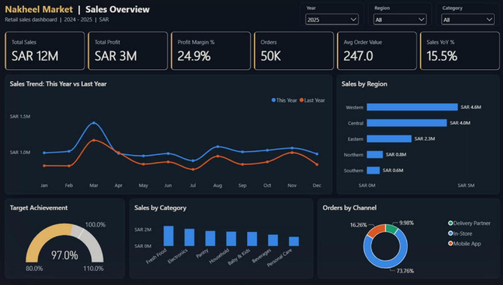
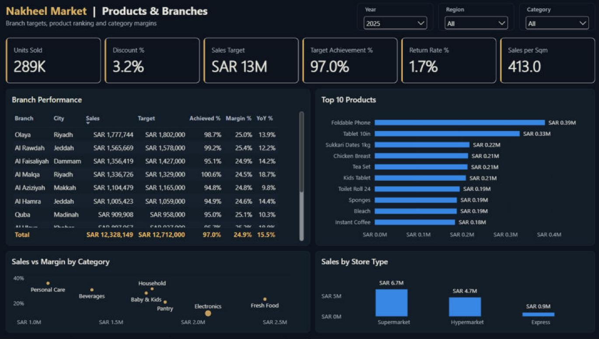
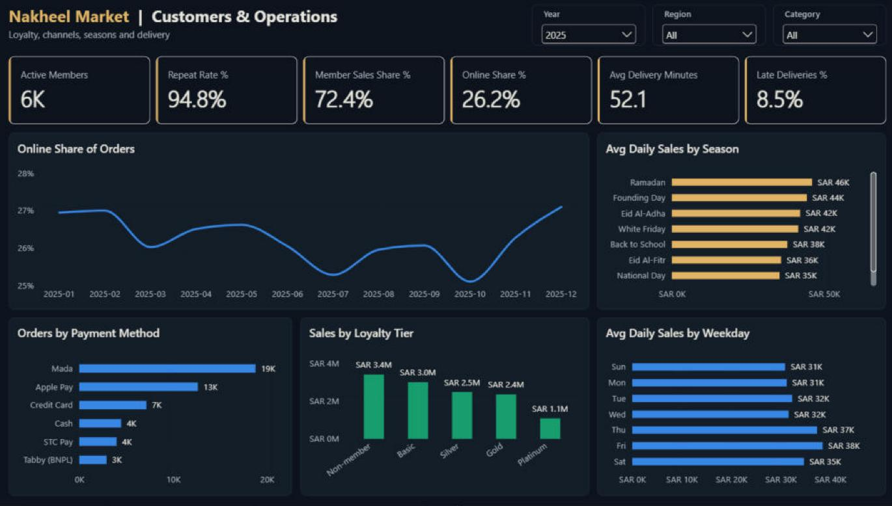

# Nakheel Market: Retail Sales Dashboard (Power BI)

A three-page Power BI report for **Nakheel Market**, a fictional supermarket chain with 12 branches across 9 Saudi cities, covering January 2024 to December 2025.

> **About the data:** every row is synthetic. I generated it with Python (`generate_data.py`) so I could practise on realistic data that I'm free to share. It doesn't contain any real company or customer information. The data follows real Saudi retail patterns: Ramadan, both Eids, White Friday, National Day, Founding Day and back-to-school.

## Business questions
1. How are sales and profit trending against last year, and against branch targets?
2. Which categories and products make money, and which only bring in revenue?
3. How much do seasons like Ramadan and White Friday lift sales?
4. How fast is the shift to online orders, and how good is delivery?

## Data model
Star schema with 2 fact tables and 4 dimensions:

| Table | Rows | Description |
|---|---|---|
| `FactSales` | 221,265 | One row per order line: quantity, price, discount, net sales, cost, profit, return flag, delivery time |
| `FactTargets` | 286 | Monthly sales target per branch |
| `DimDate` | 731 | Calendar with year, month, weekday and Saudi retail **season** |
| `DimProduct` | 177 | 7 categories, 24 sub-categories, brands, list price and cost |
| `DimBranch` | 12 | City, region, store type, size (m²), manager, coordinates |
| `DimCustomer` | 6,001 | Gender, age group, loyalty tier, home branch (`C00000` = walk-in) |

## Measures
37 DAX measures in [`powerbi/DAX_Measures.dax`](powerbi/DAX_Measures.dax), including:
- **Sales:** Total Sales, Profit, Margin %, Orders, Avg Order Value, Discount %
- **Time intelligence:** Sales LY, YoY %, YTD, MTD, 3-month rolling
- **Targets:** Sales Target, Achievement %, Gap, Status
- **Customers:** Active Members, Repeat Rate %, Member Sales Share %
- **Operations:** Return Rate %, Online Share %, Avg Delivery Minutes, Late Deliveries % (>90 min)
- **Ranking:** Product Rank and Top 10 Product Sales

## Report pages
| Overview | Products & Branches | Customers & Operations |
|---|---|---|
|  |  |  |

## Key findings (2025)
- Net sales reached **SAR 12.3M, up 15.5%** on 2024, with a profit margin of 24.9%.
- Average daily sales during **Ramadan run about 45% above** a regular day; White Friday is next at about 35%.
- **Electronics** is the second-biggest category by sales, but it has the lowest margin (12%) and a return rate of 8.3%, versus 1.4% for everything else.
- **Online orders** grew from 18% to 26% of all orders; average delivery time is 52 minutes and 8.5% of deliveries take longer than 90 minutes.
- Only **1 of 12 branches** (Al Malqa) met its annual target; the others finished between 94.8% and 99.2%.

## How to open it
1. Download the repository and unzip `data/FactSales.zip` (the fact table is zipped to keep the repo light).
2. Open `Nakheel_Market_Sales_Dashboard.pbix` in Power BI Desktop.
3. If the data path differs on your machine: **Transform data → Edit parameters → DataFolder** and point it to the `data` folder.

## Tools
Power BI Desktop · Power Query (M) · DAX · Python (pandas, NumPy) for data generation

---
Roaa Alghamdi · [Portfolio](https://roaa-alghamdi.github.io) · [LinkedIn](https://www.linkedin.com/in/roaa-alghamdi-814068328)
